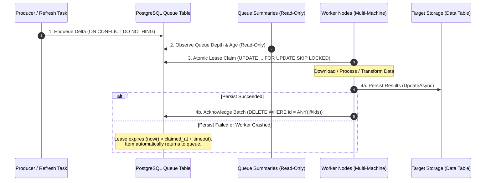

# AI Guidelines: PostgreSQL Distributed Queue Processing

**Environment:** PostgreSQL 15+ / 18, Npgsql, ASP.NET Core, .NET 10 (`net10.0`), C# 12.  
**Reference implementation:** the orthophoto download queue `orto_datas_building_2d_reference_update` — `OrtoDatasPostgreSQLConverter.UpdateBuilding2DReferencesAsync` (enqueue), `GetNextBuilding2DReferencesAsync` (retire + claim), `AcknowledgeBuilding2DReferencesAsync`, `GetQueueSummariesByCountyIdsAsync`, and the `nextbuilding2dreferences` / `acknowledgebuilding2dreferences` / `queuesummariesbycountyids` actions of `OrtoDatasController`. When this document and that code disagree, the code is the current state — fix the document.  
**Domain:** Distributed background processing, multi-machine bulk updates, resilient claim/acknowledge queues, and GIS data pipelines (`DiGi.PostgreSQL`, `DiGi.GIS.PostgreSQL`, `DiGi.GIS.WebAPI`).

---

## 1. Architectural Overview & Workflow

When processing millions of records across multiple machines (e.g., downloading orthophotos/satellite imagery for building footprints, running ML inference, or performing heavy geometric transformations), updating records directly in monolithic loops or fetching items with immediate deletion causes catastrophic failure modes.

### 🚫 The Destructive Drain Anti-Pattern
A naive implementation reads and removes work in a single step (`DELETE FROM queue ... RETURNING ...`).
- **Work is lost on failure:** If a worker crashes, times out, loses network connectivity, or fails during downstream processing, the deleted rows are gone permanently.
- **The queue is unobservable:** A queue that deletes on read cannot be inspected. Administrators and monitoring tools cannot measure queue depth, track age, or detect stalled partitions without draining the queue.

### The 4-Stage Claim/Acknowledge Pipeline
The DiGi distributed queue architecture separates data staging from destructive consumption using a robust four-stage lifecycle:



1. **Enqueue / Refresh:** The producer identifies missing or outdated records across partitions, preparing delta records and inserting them into the queue with `ON CONFLICT DO NOTHING` for idempotency.
2. **Observe:** Read-only summary endpoints report queue depth, age distribution, and partition statistics without claiming or modifying rows.
3. **Atomic Claim:** Workers lease batches non-destructively by setting `claimed_at = now()` and incrementing `attempts`, using `FOR UPDATE SKIP LOCKED`. Rows that already used up their attempts are retired just before the claim (section 4).
4. **Two-Phase Acknowledge:** After successfully storing the computed results into the target table, the worker explicitly deletes the completed queue IDs. If a failure occurs, acknowledgment is skipped, and the expired lease returns the item to the queue automatically.

---

## 2. Queue Table Schema & Index Standards

Update queue tables are stored as single unpartitioned tables named `{TargetTable}_{EntityType}_update` (e.g., `orto_datas_building_2d_reference_update`).

### Standard DDL Definition
The DDL method in `Create/TableAsync.cs` must define the table with both creation and migration statements:

```sql
CREATE TABLE IF NOT EXISTS {tableName} (
    id BIGINT GENERATED ALWAYS AS IDENTITY,
    county_id INT NOT NULL,
    reference TEXT NOT NULL,
    subdivision_id INT,
    created_at timestamptz DEFAULT now(),
    claimed_at timestamptz,
    attempts INT NOT NULL DEFAULT 0,
    PRIMARY KEY (id, county_id)
);

-- Backward-compatible column migrations for existing databases
ALTER TABLE {tableName} ADD COLUMN IF NOT EXISTS claimed_at timestamptz;
ALTER TABLE {tableName} ADD COLUMN IF NOT EXISTS attempts INT NOT NULL DEFAULT 0;

-- Prevent duplicate queuing of the same entity within a partition
CREATE UNIQUE INDEX IF NOT EXISTS idx_{tableName}_county_id_reference
    ON {tableName} (county_id, reference);

-- FIFO ordering index for queue processing
CREATE INDEX IF NOT EXISTS idx_{tableName}_created_at
    ON {tableName} (created_at ASC);

-- Optimized index for claiming unclaimed or expired items
CREATE INDEX IF NOT EXISTS idx_{tableName}_claimed_at
    ON {tableName} (claimed_at ASC NULLS FIRST, created_at ASC);
```

### Key Schema Rules
1. **`id BIGINT GENERATED ALWAYS AS IDENTITY`:** Serves as the unique identity handle passed back to workers and used for explicit batch deletion.
2. **`claimed_at timestamptz` (Nullable):** `NULL` indicates the item is ready to be processed. A timestamp indicates an active lease.
3. **`UNIQUE (county_id, reference)`:** Enforces that a refresh run appending tens of thousands of references never enqueues duplicates.
4. **Composite Claim Index:** `(claimed_at ASC NULLS FIRST, created_at ASC)` allows PostgreSQL to quickly scan for unclaimed items (`NULLS FIRST`) or expired leases in FIFO creation order.
5. **`attempts INT NOT NULL DEFAULT 0`:** the number of times the row has been **claimed**. It starts at `0` and every claim adds one, so `maxAttempts = 5` means five claims. With `DEFAULT 1`, the same ceiling would allow only four (section 4).
6. **`county_id` is a county *part* id**, never a county code. A multi-part county has one id per polygon part (`Coding - GIS Administrative Data.md`), so its rows are spread across several `county_id` values. A summary or progress check for that county has to name every part.
7. **`PRIMARY KEY (id, county_id)` on an unpartitioned table.** `id` alone is unique, being an identity column. PostgreSQL requires the partition column in the key only on a table partitioned by it, and this table is not partitioned. Acknowledge and look up rows by `id`, never by the `(id, county_id)` pair.

### DDL Ownership — Every Path Runs It
The DDL method in `Create/TableAsync.cs` is the migration, and a consumer may be the first path to reach a table that predates a schema change. **Every path that reads or writes the queue table — enqueue, claim, acknowledge — runs the DDL before its own statement**, not just the producer.

`TableExistsAsync` is `SELECT to_regclass(...)`: it answers for the table and knows nothing about its columns. On a table created before `claimed_at` existed, the guard passes and the claim then raises `42703` on the column the migration was supposed to add — the failure behind `DiGi-Organization/DiGi.GIS.PostgreSQL#46`, which made the deployed download task report Failed. Because every DDL statement is conditional (`CREATE TABLE IF NOT EXISTS`, `ADD COLUMN IF NOT EXISTS`, `CREATE INDEX IF NOT EXISTS`), running it from every path costs a catalog lookup and is exactly what the enqueue path already does.

---

## 3. Atomic Lease Claiming (`FOR UPDATE SKIP LOCKED`)

### The Claim SQL Statement
Claiming rows must be atomic, non-blocking for concurrent workers, and non-destructive:

```sql
UPDATE {TableName.OrtoDatas_Building2DReference_Update}
SET claimed_at = now(),
    attempts = COALESCE(attempts, 0) + 1
WHERE id IN (
    SELECT id FROM {TableName.OrtoDatas_Building2DReference_Update}
    WHERE (claimed_at IS NULL OR claimed_at < now() - (@claimTimeoutMinutes * interval '1 minute'))
      AND COALESCE(attempts, 0) < @maxAttempts
    ORDER BY claimed_at ASC NULLS FIRST, created_at ASC
    FOR UPDATE SKIP LOCKED
    LIMIT @count
)
RETURNING id, county_id, reference, subdivision_id;
```

The same method runs the retirement `DELETE` from section 4 just before this statement.

### Critical Mechanics & Gotchas
- **Parenthesise the lease condition.** `AND` binds tighter than `OR`, so without the parentheses `claimed_at IS NULL OR <expired> AND attempts < @maxAttempts` means `claimed_at IS NULL OR (<expired> AND …)`, and a never-claimed row skips the ceiling. The retirement `DELETE` that runs first currently hides this, so nothing fails until someone copies the statement without it.
- **`FOR UPDATE SKIP LOCKED`:** Tells PostgreSQL to skip any rows currently locked by other concurrent worker transactions rather than waiting. This allows dozens of worker machines to pull batches simultaneously without lock contention or duplicate work.
- **`ORDER BY claimed_at ASC NULLS FIRST, created_at ASC` — the index it scans.** This matches the composite claim index created in section 2, so the claim scans that index instead of sorting a heap. The order is also a fairness rule: never-claimed rows sort first, so a row whose lease expired waits behind everything never attempted. Ordered by `created_at` alone, an expired lease returns to the **head** of the queue, and a worker failing on the rows it reaches first can re-attempt them forever ahead of the rest.
- **The claim path runs the DDL first (section 2), not a `TableExistsAsync` guard.** The claim statement reads and writes `claimed_at`; on a table predating the column the existence guard passes and the statement raises `42703`.
- **Lease Timeout via Native Arithmetic:** Use `(@claimTimeoutMinutes * interval '1 minute')` rather than string concatenation (`(@claimTimeoutMinutes || ' minutes')::interval`). In PostgreSQL, integer multiplication with an `interval` is native and prevents syntax or type-casting errors.
- **Re-Queueing on Crash:** If a worker machine dies or drops network connection, the lease expires when `now() - claimed_at > claimTimeoutMinutes`. The next claiming worker will automatically pick up the abandoned rows.
- **The lease must outlast the slowest batch.** A lease nobody renews expires on schedule, even while its worker is still busy. Set `claimTimeoutMinutes` above the worst-case time to process and store one batch at the `count` workers request, not the typical time. When it is too short, rows are handed to a second worker while the first is still processing them (section 4, *Acknowledgment is not owner-checked*), and each re-claim also uses up one of the row's attempts.

### Converter Method Signature Standard
```csharp
public static async Task<List<Building2DReference>?> GetNextBuilding2DReferencesAsync(
    NpgsqlConnection? npgsqlConnection,
    int count = 100,
    int claimTimeoutMinutes = 30,
    int maxAttempts = 5,
    int commandTimeout = 60,
    CancellationToken cancellationToken = default)
```
- Expose both `static` (accepting `NpgsqlConnection?`) and instance extension methods.
- Always thread `cancellationToken` and apply `commandTimeout` to `NpgsqlCommand`.
- Return `null` when the queue cannot be reached (no connection, DDL failed, `count <= 0`, `maxAttempts <= 0`) and an **empty list** when nothing is claimable. The controller maps both to `204`; a caller of the converter must not treat `null` as "drained".

---

## 4. Two-Phase Processing & Batch Acknowledgment

Workers must explicitly acknowledge successfully processed items by deleting their queue IDs.

### Acknowledgment SQL Statement
```sql
DELETE FROM {TableName.OrtoDatas_Building2DReference_Update}
WHERE id = ANY(@ids);
```

### Converter Implementation Pattern
```csharp
public static async Task<long> AcknowledgeBuilding2DReferencesAsync(
    NpgsqlConnection? npgsqlConnection,
    IEnumerable<long>? ids,
    int commandTimeout = 60,
    CancellationToken cancellationToken = default)
{
    if (npgsqlConnection is null || ids is null)
    {
        return -1;
    }

    long[] ids_Array = [.. ids];
    if (ids_Array.Length == 0)
    {
        return 0;
    }

    // The DDL rather than a mere existence check, for the same reason the claim runs it: a queue
    // table predating the claim column has to be brought up to the current shape by whichever path
    // reaches it first. Every statement in it is conditional, so this is a catalog lookup.
    if (!await Create.TableAsync_Building2DReference(npgsqlConnection, TableName.OrtoDatas_Building2DReference_Update, commandTimeout, cancellationToken))
    {
        return -1;
    }

    string commandText = $@"
        DELETE FROM {TableName.OrtoDatas_Building2DReference_Update}
        WHERE id = ANY(@ids);";

    try
    {
        await using NpgsqlCommand command = new(commandText, npgsqlConnection);
        command.CommandTimeout = commandTimeout;
        command.Parameters.Add(new NpgsqlParameter("ids", NpgsqlDbType.Array | NpgsqlDbType.Bigint) { Value = ids_Array });

        return await command.ExecuteNonQueryAsync(cancellationToken);
    }
    catch (NpgsqlException npgsqlException)
    {
        Serilog.Modify.Log(npgsqlException, "{Method} failed while acknowledging {Count} references", nameof(AcknowledgeBuilding2DReferencesAsync), ids_Array.Length);
        return -1;
    }
}
```

`-1` and `0` are different answers: `0` is a count of rows retired and must never stand for a failure, so the path returns `-1` whenever the table cannot be prepared. The WebAPI layer maps any negative result to `500` (section 6).

### The Golden Rule of Acknowledgment
> **NEVER acknowledge items before their target data is committed.**
> Acknowledgment belongs strictly *after* `UpdateAsync` / storage commit succeeds. If saving fails or throws, skip acknowledgment so the lease expires and the work is safely retried.

### Acknowledgment is not owner-checked
`DELETE … WHERE id = ANY(@ids)` deletes the rows whoever holds them now. Suppose worker A's lease expires mid-batch and worker B claims the same rows. When A stores its results and acknowledges, B's claim is deleted while B is still working. B then stores the same result again, and its own acknowledgment deletes nothing. Two rules follow:
- **The processing must be idempotent.** Storing the same reference's result twice must be harmless. The orthophoto target's `UpdateAsync` upserts by `(county_id, reference)`, which makes it so. A target that appends (a log, a counter, an insert with no unique key) is not idempotent and must not sit behind this queue as written.
- **If double work matters,** acknowledge only your own lease: return `claimed_at` from the claim and delete with `WHERE id = ANY(@ids) AND claimed_at = @claimedAt`. A late acknowledgment then deletes nothing, and the row stays with its current holder. The orthophoto queue does not do this, because the upsert makes a duplicate harmless and only wasteful.

### Re-enqueue while a row is claimed
The producer enqueues with `ON CONFLICT (county_id, reference) DO NOTHING`. If it re-enqueues a reference while that reference's row is claimed, the new entry is dropped, and the worker's acknowledgment then deletes the old row. Nothing remains in the queue for the newer request.
- This is correct when the queue entry means *"this reference needs (re)processing from the current source"* and the worker reads its input when it runs: the claimed work already covers the newer request. The orthophoto queue is this case, since the worker downloads whatever imagery the reference has at that moment.
- It is **wrong** when the entry carries a payload or describes a change that happened after the claim. Such a queue must use `ON CONFLICT … DO UPDATE SET claimed_at = NULL, attempts = 0, …` so the row goes back to the queue, and its acknowledgment must be owner-checked as above, or the reset row is deleted along with the old claim.

### Poison Rows — Attempt Counter & Retirement Ceiling

With acknowledgment correctly confined to work that was stored, a reference that can **never** resolve is never retired: the lease expires, the row is claimed again, it fails again, and the queue acquires a floor of permanently failing rows that a worker keeps reaching. A queue without an attempt counter cannot tell a transient fault from a data defect. Every queue carries the guard below. The orthophoto queue adopted it in `DiGi-Organization/DiGi.GIS.PostgreSQL#48`.

The standard guard has three parts:

1. **Attempt counter.** `attempts INT NOT NULL DEFAULT 0`: the table DDL creates it and the migration adds it to existing tables (section 2). The claim increments it (section 3), so every re-attempt after an expired lease is counted, and it also carries the ceiling (`AND COALESCE(attempts, 0) < @maxAttempts`, inside the parenthesised lease condition). `COALESCE` keeps rows predating the column claimable. `@maxAttempts` is a method parameter beside `claimTimeoutMinutes`, default `5`. The ceiling is a policy decision: high enough that transient faults (network, service outage) clear before it is reached, low enough that a reference that can never resolve is retired rather than cycled forever. Counting from `0` makes `maxAttempts` the number of claims a row gets.
2. **Retirement ceiling.** The claim method retires exhausted rows **before** it claims, so no worker ever sees them again:
   ```sql
   DELETE FROM {tableName}
   WHERE COALESCE(attempts, 0) >= @maxAttempts
   RETURNING id, county_id, reference;
   ```
   Every retired reference is logged at error level with enough identity (partition + reference) to file a data defect — a permanently failing reference is a problem worth a ticket, never a silent drop. The log lives on the server running the WebAPI that served the claim (`Coding - Deployed WebAPI.md` §5), not on the worker.
   **Cost:** there is no index on `attempts`, so this `DELETE` scans the whole queue on every claim. That is cheap at today's queue sizes. If a queue grows into the millions, measure first, then either index `attempts` or move retirement out of the claim path. A partial index cannot do the job, because its predicate is fixed at creation and cannot follow the `@maxAttempts` parameter.
3. **Retirement is not acknowledgment.** Acknowledgment retires rows whose work was **stored**; retirement discards rows whose work **provably failed** its ceiling of attempts. Both are explicit deletions, but they answer different questions, and only the former belongs inside the worker loop.

---

## 5. Non-Destructive Queue Observation

Distributed queues must be observable without modifying state or disturbing worker nodes.

The observation path is the one deliberate exception to the DDL ownership rule in section 2: it keeps `TableExistsAsync` on purpose, because an observation endpoint must not create anything. `null` there correctly means no refresh has ever run — a fact, not a fault.

### Query Implementation Pattern
```csharp
public static async Task<List<OrtoDatasQueueResult>?> GetQueueSummariesByCountyIdsAsync(
    NpgsqlConnection? npgsqlConnection,
    IEnumerable<int>? countyIds,
    int commandTimeout = 600,
    CancellationToken cancellationToken = default)
{
    if (npgsqlConnection is null)
    {
        return null;
    }

    if (!await DiGi.PostgreSQL.Query.TableExistsAsync(npgsqlConnection, TableName.OrtoDatas_Building2DReference_Update))
    {
        return null;
    }

    int[]? countyIds_Array = countyIds is null ? null : [.. countyIds];

    string commandText = $@"
        SELECT
            county_id,
            COUNT(*),
            COUNT(*) FILTER (WHERE subdivision_id IS NOT NULL),
            COUNT(*) FILTER (WHERE COALESCE(attempts, 0) > 0),
            MIN(created_at), MAX(created_at)
        FROM {TableName.OrtoDatas_Building2DReference_Update}
        {(countyIds_Array is null ? string.Empty : "WHERE county_id = ANY(@countyIds)")}
        GROUP BY county_id
        ORDER BY county_id;";

    await using NpgsqlCommand npgsqlCommand = new(commandText, npgsqlConnection);
    npgsqlCommand.CommandTimeout = commandTimeout;
    if (countyIds_Array is not null)
    {
        npgsqlCommand.Parameters.Add(new NpgsqlParameter("countyIds", NpgsqlDbType.Array | NpgsqlDbType.Integer) { Value = countyIds_Array });
    }

    List<OrtoDatasQueueResult> result = [];
    await using NpgsqlDataReader npgsqlDataReader = await npgsqlCommand.ExecuteReaderAsync(cancellationToken);
    while (await npgsqlDataReader.ReadAsync(cancellationToken))
    {
        result.Add(new OrtoDatasQueueResult(
            npgsqlDataReader.GetInt32(0),
            npgsqlDataReader.GetInt64(1),
            npgsqlDataReader.GetInt64(2),
            npgsqlDataReader.GetInt64(3),
            npgsqlDataReader.IsDBNull(4) ? null : npgsqlDataReader.GetFieldValue<DateTimeOffset>(4),
            npgsqlDataReader.IsDBNull(5) ? null : npgsqlDataReader.GetFieldValue<DateTimeOffset>(5)));
    }

    return result;
}
```

### Summary Requirements
- Group by partition/scope (e.g. `county_id`).
- Report total count (`COUNT(*)`), filtered counts (e.g. `COUNT(*) FILTER (...)`), and oldest/newest timestamps (`MIN(created_at)`, `MAX(created_at)`).
- Report the **attempted** rows (`COUNT(*) FILTER (WHERE COALESCE(attempts, 0) > 0)`, `OrtoDatasQueueResult.AttemptedCount`). Without it, a part whose rows are all failing over and over looks the same as a part that has simply not been reached yet.
- An empty result or `404 NotFound` indicates the queue is drained or not initialized.

### An empty queue does not mean the work is complete
Queue depth answers *"what is still waiting"*. It cannot answer *"is the target complete"*:
- a reference the producer never enqueued leaves no trace;
- a retired poison row has left the queue without its work being stored;
- an acknowledged batch says nothing about rows written later by another path.

Completeness is measured on the **target table**, per county part, against its source: `summariesbycountyids` for the orthophoto store, and `buildingdata/coveragebycountyid` / `terrain/coveragebycountyid` for theirs. For a batch task that runs without a queue, the coverage endpoint is the *only* progress measure. The acquisition-date backfill is such a task, measured by `ortodatas/acquisitioncoveragesbycountyids` (`DiGi-Organization/DiGi.GIS.PostgreSQL#134`). For a multi-part county, name every part in either kind of request.

---

## 6. WebAPI Controller & Client Endpoints

### Controller Endpoints
Controllers expose two endpoints for queue interaction:

```csharp
[HttpPost("nextbuilding2dreferences", Name = $"{nameof(OrtoDatasController)}_{nameof(NextBuilding2DReferencesAsync)}")]
[ProducesResponseType(typeof(List<Building2DReference>), StatusCodes.Status200OK)]
[ProducesResponseType(StatusCodes.Status204NoContent)]
[ProducesResponseType(StatusCodes.Status400BadRequest)]
public async Task<IActionResult> NextBuilding2DReferencesAsync([Minimum(1), FromQuery(Name = "count")] int count = 100, [Minimum(1), FromQuery(Name = "claimtimeoutminutes")] int claimTimeoutMinutes = 30, [Minimum(1), FromQuery(Name = "maxattempts")] int maxAttempts = 5, [Minimum(0), FromQuery(Name = "commandtimeout")] int commandTimeout = 60, CancellationToken cancellationToken = default)
{
    if (count <= 0) return BadRequest("Count must be greater than 0.");
    if (claimTimeoutMinutes <= 0) return BadRequest("Claim timeout minutes must be greater than 0.");
    if (maxAttempts <= 0) return BadRequest("Max attempts must be greater than 0.");
    if (commandTimeout < 0) return BadRequest();
    if (ortoDatasPostgreSQLConverter is null) return BadRequest();

    List<Building2DReference>? references = await ortoDatasPostgreSQLConverter.GetNextBuilding2DReferencesAsync(
        count, claimTimeoutMinutes, maxAttempts, commandTimeout, cancellationToken: cancellationToken);

    if (references is null || references.Count == 0) return NoContent();

    return Content(Core.Convert.ToSystem_String(references) ?? string.Empty, "application/json");
}

[HttpPost("acknowledgebuilding2dreferences", Name = $"{nameof(OrtoDatasController)}_{nameof(AcknowledgeBuilding2DReferencesAsync)}")]
[ProducesResponseType(typeof(long), StatusCodes.Status200OK)]
[ProducesResponseType(StatusCodes.Status400BadRequest)]
[ProducesResponseType(StatusCodes.Status500InternalServerError)]
public async Task<IActionResult> AcknowledgeBuilding2DReferencesAsync(
    [FromBody] IEnumerable<long>? ids,
    CancellationToken cancellationToken = default)
{
    if (ids is null || !ids.Any()) return BadRequest("The ids collection cannot be null or empty.");
    if (ortoDatasPostgreSQLConverter is null) return BadRequest();

    long count_Deleted = await ortoDatasPostgreSQLConverter.AcknowledgeBuilding2DReferencesAsync(ids, cancellationToken: cancellationToken);
    if (count_Deleted < 0) return StatusCode(500, "Internal server error during acknowledgement");

    return Ok(count_Deleted);
}
```

### Worker / Background Task Loop
```csharp
while (postResponse_References?.Result is List<Building2DReference> references && references.Count > 0)
{
    cancellationToken.ThrowIfCancellationRequested();

    // 1. Process batch
    List<OrtoDatas> processedData = await ProcessBatchAsync(references, cancellationToken);

    // 2. Persist to storage
    bool saved = await TargetConverter.UpdateAsync(processedData);

    // 3. Acknowledge only on success
    if (saved)
    {
        List<long> ids = [.. references.Where(x => x.Id > 0).Select(x => x.Id)];
        if (ids.Count > 0)
        {
            await AcknowledgeAsync(ids, cancellationToken);
        }
    }

    // 4. Fetch next batch
    postResponse_References = await FetchNextBatchAsync(cancellationToken);
}
```

---

## 7. Implementation Checklist

When implementing a new distributed queue in DiGi solutions, verify:

- [ ] Queue table schema includes `claimed_at timestamptz` and `attempts INT NOT NULL DEFAULT 0`, each with its `ADD COLUMN IF NOT EXISTS` migration?
- [ ] Every claim and acknowledge path runs the DDL rather than checking existence?
- [ ] Unique constraint on `(county_id, reference)` prevents duplicate queuing, with `county_id` a county **part** id?
- [ ] Composite index on `(claimed_at ASC NULLS FIRST, created_at ASC)` created?
- [ ] Claim statement orders by `claimed_at ASC NULLS FIRST, created_at ASC`, so an expired lease cannot pre-empt never-attempted rows?
- [ ] Claim statement uses `FOR UPDATE SKIP LOCKED` and native interval multiplication (`@minutes * interval '1 minute'`)?
- [ ] Claim statement increments `attempts` and parenthesises the lease condition before `AND COALESCE(attempts, 0) < @maxAttempts`?
- [ ] Claim method accepts `count`, `claimTimeoutMinutes`, `maxAttempts`, `commandTimeout`, and `CancellationToken`, and the controller binds `maxattempts`?
- [ ] `claimTimeoutMinutes` exceeds the worst-case time to process and store one batch?
- [ ] Acknowledge method deletes by ID array (`WHERE id = ANY(@ids)`), and the target write is idempotent, or the acknowledgment is owner-checked on `claimed_at`?
- [ ] Re-enqueue of a claimed reference is either covered by the in-flight work (`DO NOTHING`) or resets the row (`DO UPDATE`), and that choice is documented on the producer?
- [ ] Retirement runs before the claim and logs every retired reference at error?
- [ ] Workers invoke acknowledgment **only after** storage write completes successfully?
- [ ] Read-only observation endpoint (`queuesummaries...`) exists, reports attempted rows, and does not drain the queue?
- [ ] Completeness is measured on the target table per county part, not inferred from an empty queue?
- [ ] All public methods and endpoints have comprehensive XML documentation?
